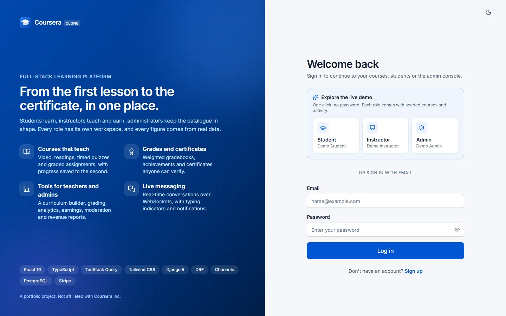
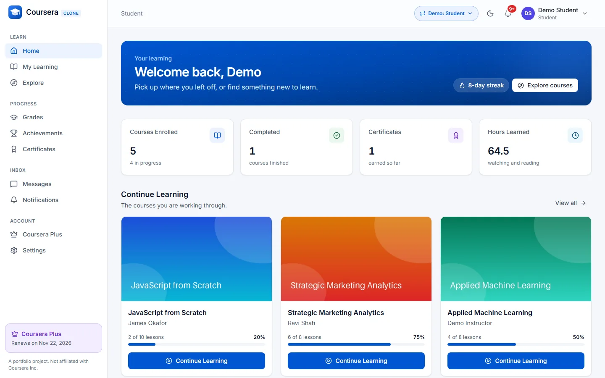
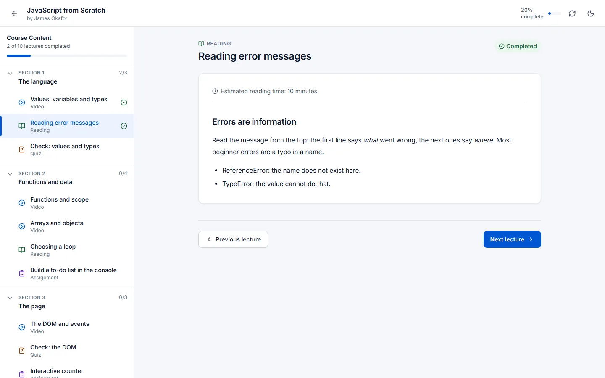
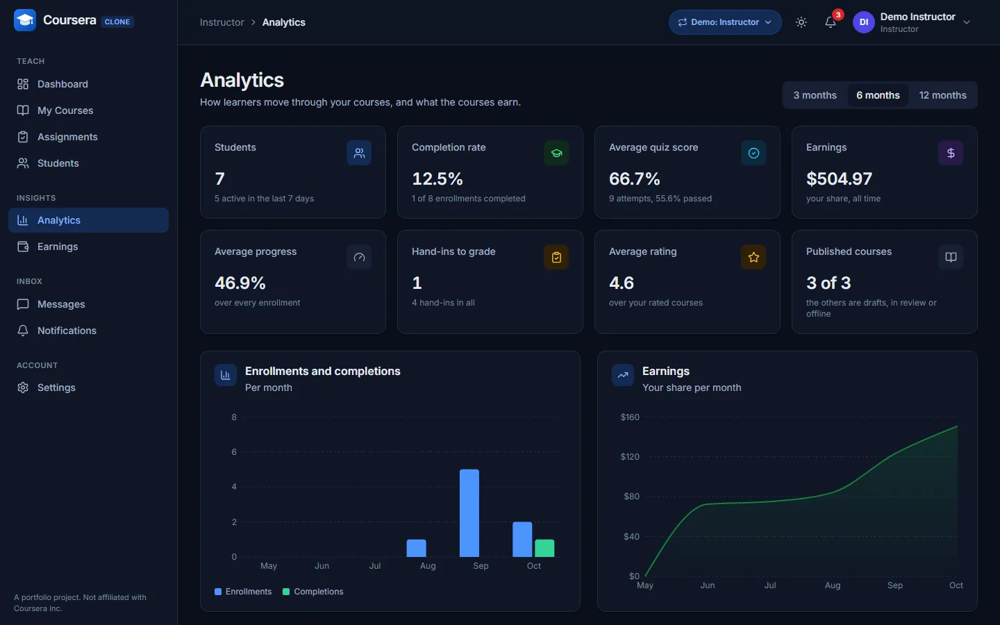
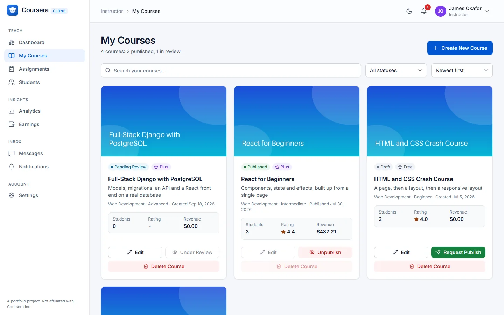
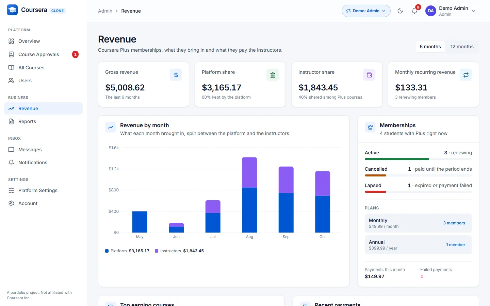
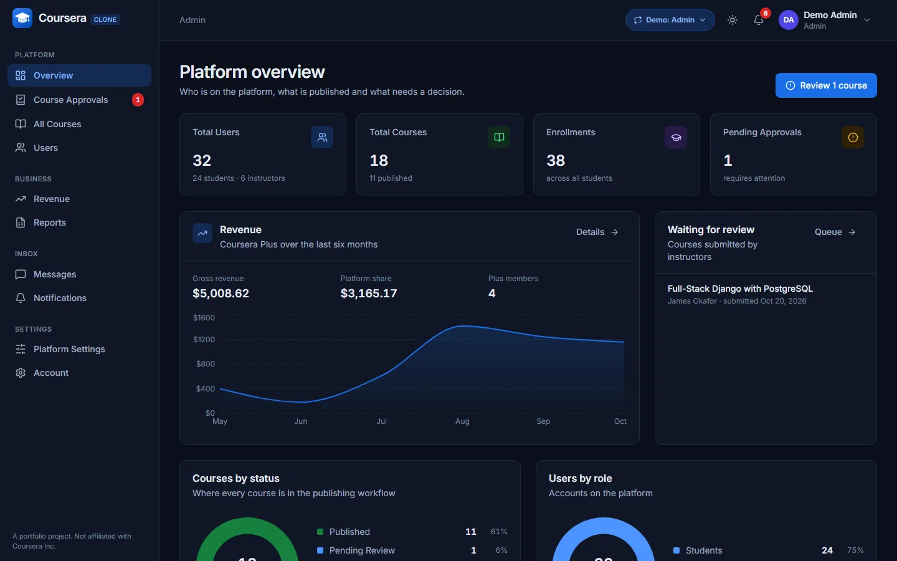
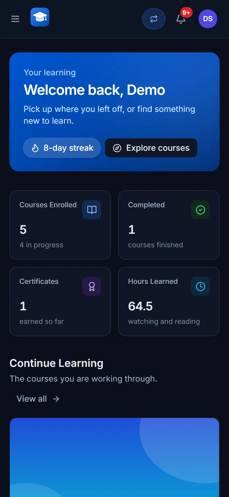

# Coursera clone

[](https://github.com/anas-irfan786/coursera/actions/workflows/ci.yml)

A full-stack learning platform with three roles, each with its own workspace:

* **Students** browse the catalogue, enrol, learn in a course player (video, readings, timed quizzes, graded assignments), follow their grades, achievements and certificates, message instructors and classmates, and subscribe to Plus with Stripe.
* **Instructors** build courses with a drag-and-drop curriculum editor, submit them for review, grade hand-ins, and follow their learners, analytics and monthly earnings.
* **Administrators** moderate the catalogue, manage users, follow revenue and memberships, download CSV reports and set the Plus prices.

Light and dark themes, a responsive layout from phone to desktop, real-time messaging over WebSockets, and a seeded world (32 people, 18 courses, months of activity) behind every screen. A portfolio project: not affiliated with Coursera Inc.

| | |
|---|---|
|  |  |
|  |  |
|  |  |
|  |  |

```
backend/    Django 5 + DRF + Channels API         python manage.py ...
frontend/   React 19 + TypeScript single page app pnpm start
package.json pnpm dev starts both of them: backend on :8000, frontend on :3000
docs/       ARCHITECTURE.md: slices, rules, how to extend; DESIGN.md: the design system
```

Both sides are organised by the same product slices (identity, authoring, monetisation, learning, assessment, engagement, recognition, insight); see [docs/ARCHITECTURE.md](docs/ARCHITECTURE.md) for the slices and their rules, [docs/CONVENTIONS.md](docs/CONVENTIONS.md) for how code is written, [docs/DESIGN.md](docs/DESIGN.md) for the design system (tokens, themes, components), [backend/README.md](backend/README.md) and [frontend/README.md](frontend/README.md) for each side, and [docs/CI.md](docs/CI.md) for the pipeline.

## Quickstart

Backend, on SQLite (nothing else to install):

```bash
python -m venv .venv
source .venv/bin/activate          # Windows: .venv\Scripts\activate
pip install -r backend/requirements-dev.txt

cd backend
cp .env.example .env               # DB_ENGINE=sqlite in the example
python manage.py migrate
python manage.py seed_dev          # a cast, a catalogue and activity; prints the shared password once
python manage.py runserver         # http://localhost:8000 (HTTP and WebSockets)
```

Frontend:

```bash
cd frontend
cp .env.example .env               # REACT_APP_API_URL=http://localhost:8000/api/v1
corepack enable                    # once: pnpm in the version package.json names (or: npm install -g pnpm@10)
pnpm install
pnpm start                         # http://localhost:3000
```

Both at once, from the repository root (it runs `scripts/dev.mjs` and nothing else):

```bash
pnpm install                       # once: installs the launcher only
pnpm dev                           # backend on :8000, frontend on :3000; Ctrl+C stops both
```

It uses the Python of `.venv` when there is one (otherwise the first `python` on the PATH; `PYTHON=...`
overrides, and is an executable: it is run as a program, not as a command line) and tells the frontend where
the API is (`REACT_APP_API_URL` and `REACT_APP_WS_URL`), whatever `frontend/.env` and the environment say. It
refuses to start when :8000 or :3000 is taken (the backend allows the frontend on :3000 only), and when one of
the two stops, the other is stopped too. It does not install, migrate or seed anything: do the steps above first.

### PostgreSQL

Install PostgreSQL 14 or newer (or use `docker compose`, below), then in `backend/.env`:

```
DB_ENGINE=postgres
DB_NAME=coursera_db
DB_USER=coursera_admin
DB_PASSWORD=choose-one              # there is no built-in password
```

and create the role and the database once; the command asks for the password of the `postgres` superuser:

```bash
python manage.py create_dev_database
python manage.py migrate
python manage.py seed_dev
```

With Docker instead: `DB_PASSWORD=choose-one docker compose up -d` starts PostgreSQL 16 and Redis 7 with the same names; set `REDIS_URL=redis://localhost:6379/0` in `.env` if the API and the socket consumers run in different processes.

### Development data

`seed_dev` fills the database with 32 people, 18 courses and a few months of activity, played through the application's own services, so every screen of the three roles has something to show and every reachable state has an example (draft, pending and rejected courses, learners from 0 to 100 percent, passed and failed quizzes, graded and waiting hand-ins, Plus members, lapsed and cancelled memberships, unread notifications and messages, empty accounts).

```bash
python manage.py seed_dev                    # create what is missing; safe to repeat
python manage.py seed_dev --reset            # remove the seeded people and what hangs off them, seed again
python manage.py seed_dev --list             # the accounts and what to try with each; touches nothing
python manage.py seed_dev --password ...     # or SEED_PASSWORD in backend/.env, else random and printed once
```

All seeded accounts share one password and use `@example.com` addresses. In development the login page also offers **Explore the live demo**: one click signs in as the demo student, instructor or admin (no password), and a demo account can switch roles from the top bar (`DEMO_MODE`, see *Running it as a public demo*). The accounts to start with:

| Account | Role | Why |
|---|---|---|
| `demo.student@example.com` | student | Plus member, five enrolments from 0 to 100 percent, a certificate, 10+ unread notifications, four conversations |
| `amara.okoye@example.com` | student | yearly Plus, an eight-day streak, two certificates |
| `mei.lin@example.com` | student | registered, nothing else: the empty states |
| `demo.instructor@example.com` | instructor | the two demo courses and a course waiting for approval |
| `james.okafor@example.com` | instructor | featured course, a pending course, a course taken offline with learners enrolled |
| `noah.bennett@example.com` | instructor | no courses: the empty instructor screens |
| `demo.admin@example.com` | admin | two courses waiting in the approvals queue, every list |

`seed_demo` is the smaller sibling (three accounts and two courses); `seed_dev` runs it first. Both refuse to run when `DEBUG` is off unless `--force` is given, and the production settings only install them in demo mode.

### Stripe

Checkout needs a test-mode secret key and the webhook secret in `backend/.env` (`STRIPE_SECRET_KEY`, `STRIPE_WEBHOOK_SECRET`; checkout redirects to Stripe, so no publishable key is needed). Point the webhook at `/api/payments/stripe/webhook/` and set `FRONTEND_URL` to where the React app runs.

## Checks

```bash
cd backend
python -m pytest --cov            # SQLite; TEST_DB_ENGINE=postgres for PostgreSQL; fails under 90 % coverage
ruff check apps config tests      # rules and docstrings: backend/ruff.toml
lint-imports                      # slices depend downwards only, no HTTP in the domain
python manage.py makemigrations --check --dry-run

cd ../frontend
pnpm run lint                     # includes the module boundaries
pnpm run typecheck                # tsc, the tests included
pnpm run test:ci                  # Jest with coverage
pnpm run build                    # warnings fail it

cd ../e2e
pnpm test                         # browser specs against the seeded stack (start the API with
                                  # THROTTLE_LOGIN=1000/min: they sign in dozens of times a minute), see docs/CI.md
```

CI (`.github/workflows/ci.yml`) runs all of it in parallel on every pull request, adds dependency
and secret scanning and posts the test report on the pull request. What each job guarantees and
how to run it locally: [docs/CI.md](docs/CI.md).

## Configuration

Local development needs none of the backend variables: `config.settings.dev` supplies safe defaults.
A deployment runs `config.settings.prod` (the default of `wsgi.py` and `asgi.py`), which **refuses to
start** and names every missing variable marked *required* below.

| Variable | Where | Meaning |
|---|---|---|
| `SECRET_KEY` | backend | signs sessions and JWTs; **required in production**, a development key is refused |
| `ALLOWED_HOSTS` | backend | host names served; **required in production** |
| `CORS_ALLOWED_ORIGINS` | backend | origins of the React app; **required in production** (localhost in development) |
| `FRONTEND_URL` | backend | where Stripe sends customers back; **required in production** |
| `DB_ENGINE` | backend | `sqlite` or `postgres` (default) |
| `DB_NAME`, `DB_USER`, `DB_PASSWORD`, `DB_HOST`, `DB_PORT` | backend | PostgreSQL connection (no default password; `DB_PASSWORD` is required in production) |
| `REDIS_URL` | backend | Channels layer; in-memory when empty (required in production unless `CHANNEL_LAYER=memory`) |
| `BEHIND_TLS_PROXY` | backend | production only: trust the proxy's `X-Forwarded-Proto` |
| `JWT_ACCESS_LIFETIME_MINUTES`, `JWT_REFRESH_LIFETIME_DAYS` | backend | token lifetimes (60 and 7) |
| `AUTH_COOKIE_ACCESS`, `AUTH_COOKIE_REFRESH`, `AUTH_COOKIE_SECURE`, `AUTH_COOKIE_SAMESITE`, `AUTH_COOKIE_DOMAIN` | backend | the HttpOnly session cookies (`Secure` is always on in production; `Lax` needs the app and the API on one site) |
| `AUTH_LEGACY_TOKEN_TRANSPORT` | backend | keep the token pair in login answers and accept the refresh token in a body (`True`: the release before cookies, scripts) |
| `LOG_LEVEL` | backend | level of the application's loggers (`INFO`) |
| `THROTTLE_LOGIN`, `THROTTLE_SIGNUP`, `THROTTLE_REFRESH`, `THROTTLE_MESSAGES`, `THROTTLE_UPLOADS`, `THROTTLE_PROGRESS`, `THROTTLE_ANON`, `THROTTLE_USER` | backend | request rates (`10/min` ... `1200/min`); counters are shared through `REDIS_URL` |
| `NUM_PROXIES` | backend | reverse proxies in front of the API (0): the client address is the matching `X-Forwarded-For` hop |
| `API_LEGACY_ALIASES`, `API_LEGACY_SUNSET` | backend | keep the unversioned `/api/<slice>/` paths (deprecated) and announce the day they go |
| `QUIZ_SUBMIT_GRACE_SECONDS` | backend | how late a quiz answer may arrive after its time limit (30) |
| `COURSE_PASSING_GRADE` | backend | weighted grade that earns a certificate (60) |
| `INSTRUCTOR_REVENUE_SHARE_PERCENT` | backend | share of the month's Plus payments that goes to instructors (40) |
| `SEED_PASSWORD` | backend | password of the users `seed_dev` creates (random when empty) |
| `DEMO_MODE` | backend | the one-click demo sign-in on the login page and the role switch; the demo accounts keep their password (on in development, off in production unless set) |
| `SERVE_MEDIA` | backend | let Django serve `/media/` with `DEBUG` off (a demo that runs as one process; a real deployment serves uploads from its proxy or object storage) |
| `STRIPE_SECRET_KEY`, `STRIPE_WEBHOOK_SECRET` | backend | Stripe test secret key (no default) and webhook secret |
| `REACT_APP_API_URL` | frontend | API base; **required for a production build** (`pnpm run build` stops without it), `http://localhost:8000/api/v1` in development; a path (`/api/v1`) when the app and the API share one origin |
| `REACT_APP_WS_URL` | frontend | WebSocket base, derived from the API URL (or from the page, for a path) by default |

`backend/.env.example` lists the rest.

## Running it as a public demo

The code is ready to run as a portfolio demo; hosting it is a separate step. What an instance needs:

1. **One site.** The session lives in `SameSite=Lax` cookies, so the app and the API must share a site: serve both
   from one origin (a proxy sends `/api`, `/ws` and `/media` to Daphne and everything else to the built app), or use
   `app.` and `api.` of one domain.
2. **The frontend**, built once: `REACT_APP_API_URL=/api/v1 pnpm run build` for one origin (or the API's full URL),
   then serve `frontend/build` with a fallback to `index.html`.
3. **The backend** on `config.settings.prod` with `SECRET_KEY`, `ALLOWED_HOSTS`, `CORS_ALLOWED_ORIGINS` and
   `FRONTEND_URL` (the site's origin), PostgreSQL (`DB_*`), and `REDIS_URL` or `CHANNEL_LAYER=memory` for a
   single process. Run it with Daphne (`daphne config.asgi:application`) so WebSockets work; set `BEHIND_TLS_PROXY`
   and `NUM_PROXIES=1` behind a TLS proxy.
4. **Demo data**: with `DEMO_MODE=True`, run `python manage.py migrate` and then
   `python manage.py seed_dev --force --password <something long>` once. The login page then offers the three demo
   roles; `seed_dev --reset --force` puts the world back the way it was after visitors changed it.
5. **Uploads** (the course pictures are files): keep `backend/media` on a persistent disk, and either let the proxy
   serve `/media/` or set `SERVE_MEDIA=True`.
6. **Stripe** stays in test mode (`sk_test_...` and its webhook secret); without a key the checkout answers that the payment provider could not process the request, and everything else works.

`python manage.py check --deploy` under the production settings must stay quiet (CI runs it).
