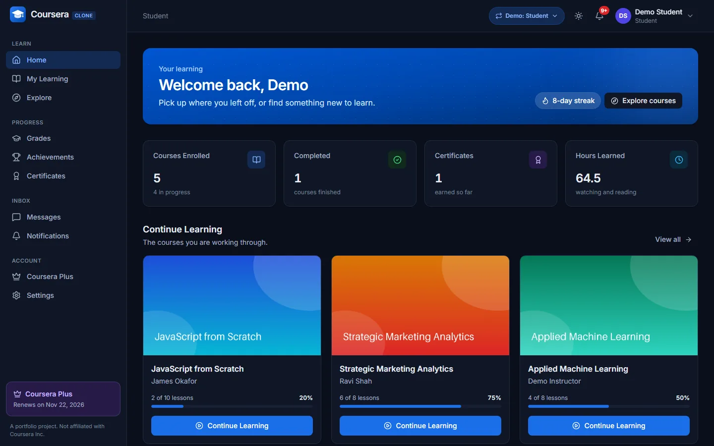

# Design system

The front end has one look, built from one set of colour tokens and one kit of components
(`frontend/src/shared/ui`). A page is assembled from the kit; it does not style raw elements with
palette colours. Light and dark themes are the same tokens with other values, so a page written
with tokens works in both without a single `dark:` class.

## Tokens

Defined as CSS variables in `frontend/src/index.css` (`:root` for light, `.dark` for dark) and
mapped to class names in `frontend/tailwind.config.js`.

| Token | Classes | Use |
|---|---|---|
| canvas | `bg-canvas` | the page behind everything |
| surface | `bg-surface`, `bg-surface-muted`, `bg-surface-raised` | cards and bars; subtle fills (table headers, hover, inputs that are read only); dialogs and popovers |
| line | `border-line`, `border-line-strong`, `divide-line` | borders and dividers; the stronger one around form controls |
| fg | `text-fg`, `text-fg-muted`, `text-fg-subtle` | text: primary, secondary, tertiary (hints, captions, placeholders) |
| primary | `bg-primary`, `hover:bg-primary-hover`, `text-primary-contrast`, `bg-primary-soft`, `text-primary-fg`, `ring-ring` | the brand blue: main buttons, links, the active navigation item, focus rings |
| success, warning, danger, info, plus | `bg-<tone>`, `bg-<tone>-soft`, `text-<tone>-fg` | a solid fill (white text on it), a tint, and text that reads on a surface or on the tint. `plus` is the Coursera Plus violet |
| chart-1 ... chart-6 | `useChartTheme().series` | the categorical palette of charts |
| brand-50 ... brand-950 | `from-brand-600 to-brand-900` | fixed brand ramp, for gradients and illustrations only |

Rules:

* No `bg-white`, `text-gray-*`, `bg-indigo-*` and the like in pages: use the tokens. The few
  decorative exceptions (avatar colours, brand gradients) live in the kit.
* Status colours come from one place: `shared/lib/courseStatus.ts` for course states, `Badge`
  tones for everything else.
* Every interactive element shows a focus ring (`focus-visible:ring-2 focus-visible:ring-ring`); the
  kit's components already do.

## The theme

`shared/theme`: `ThemeProvider` keeps the choice (`light`, `dark`, `system`) in `localStorage`
under `theme` and sets the `dark` class on `<html>`; a script in `public/index.html` applies the
saved choice before the first paint. `useTheme()` reads and changes it; `ThemeToggle` (top bar)
and `ThemePicker` (account settings) are the two controls.

| Light | Dark |
|---|---|
|  |  |

## Components

| Component | File | When |
|---|---|---|
| `Button`, `ButtonLink`, `ButtonAnchor`, `IconButton` | `Button.tsx` | every button and button-shaped link: `variant` (`primary`, `secondary`, `ghost`, `soft`, `danger`, `danger-soft`, `success`), `size` (`xs` ... `lg`), `icon`, `loading`. An icon-only button needs a `label` |
| `Card`, `CardHeader`, `CardBody`, `CardFooter` | `Card.tsx` | every panel; `as="article"` for a list of items, `interactive` for a clickable card |
| `PageHeader`, `SectionHeader` | `PageHeader.tsx` | the one `h1` of a page with its description and actions; the `h2` of a section |
| `StatCard`, `Metric` | `StatCard.tsx` | headline figures (label, value, hint, icon, tone); small number-over-label figures inside a card |
| `Badge` | `Badge.tsx` | short statuses and types; `TONE_SOFT` / `TONE_TEXT` for tinted icon tiles and coloured text |
| `StatusBadge` | `StatusBadge.tsx` | a course's moderation state |
| `Field`, `FieldGroup` | `Field.tsx` | a label, a control, a hint and an error, tied together for screen readers |
| `Input`, `Textarea`, `Select`, `SearchInput` | `Input.tsx` | text controls; `inputClasses()` for the rare custom one |
| `Checkbox`, `Switch` | `Checkbox.tsx` | a tick box with its label; an on/off setting |
| `SegmentedControl` | `SegmentedControl.tsx` | one choice out of a few (`variant="cards"` for options with descriptions) |
| `Tabs` | `Tabs.tsx` | views of one page (`role="tablist"`, arrow keys) |
| `Table`, `THead`, `TBody`, `TR`, `TH`, `TD` | `Table.tsx` | tabular data; scrolls sideways inside its card on a phone |
| `ProgressBar` | `ProgressBar.tsx` | progress and shares |
| `Callout` | `Callout.tsx` | a note, a warning or a confirmation inside a page |
| `FileDrop` | `FileDrop.tsx` | a file to pick or drop (thumbnails, videos, readings, hand-ins), with the current and the chosen file |
| `ThemeToggle`, `ThemePicker` | `ThemeToggle.tsx` | light and dark in one click (top bar); light, dark or system (account settings) |
| `EmptyState`, `ErrorState`, `PageSpinner`, `Spinner`, `Skeleton` | | the three states of every screen that loads data |
| `Modal`, `ModalFooter`, `Drawer`, `useConfirm()`, `useToast()` | | dialogs (they all share `useDialog`: Escape, focus trap, scroll lock); confirmations; toasts |
| `Menu`, `MenuItem`, `usePopover` | `Menu.tsx`, `usePopover.ts` | a button that opens actions; any other popover |
| `Avatar`, `CourseThumbnail`, `Logo` | | people (initials, drawn locally), courses (a picture or a branded placeholder), the brand |
| `useChartTheme`, `axisProps`, `ChartTooltip`, `ChartLegend` | `charts.tsx` | Recharts in the colours of the theme |

## Page anatomy

* The shell (`app/layouts/AppShell.tsx`) draws the navigation, the top bar and a centred `main`
  (`max-w-7xl`, responsive padding). A page starts with `PageHeader` and stacks its sections with
  `space-y-6`.
* Figures first: a row of `StatCard`s in `grid grid-cols-2 gap-3 sm:gap-4 xl:grid-cols-4`.
* Two columns where there is a list and its detail, or a main column and a side column:
  `grid gap-6 lg:grid-cols-3` with the main part `lg:col-span-2`. Everything is one column below `lg`.
* Toolbars (search, filters, sort) sit in a `flex flex-col gap-3 sm:flex-row` row; filters that
  switch views are `Tabs`, filters that narrow a list are `Select`s with a visible or screen-reader label.
* Lists of things are cards in `grid gap-4 sm:grid-cols-2 xl:grid-cols-3`; tabular data is a `Table`
  inside a `Card`.
* Every screen that loads data has a loading state (`PageSpinner`), an error state with a retry
  (`ErrorState`) and an empty state that says what to do (`EmptyState`). A figure that could not be
  loaded is "-", never 0.

## Responsive and accessible

* Mobile first. Nothing may scroll the page sideways: wide content (tables, code) scrolls inside
  its own box.
* Dialogs are bottom sheets on a phone and centred panels from `sm` up; their buttons stack.
* Touch targets are at least 32 px; icon-only buttons have a label (`IconButton`).
* Text and its background keep a WCAG AA contrast in both themes (the token values were chosen for it).
